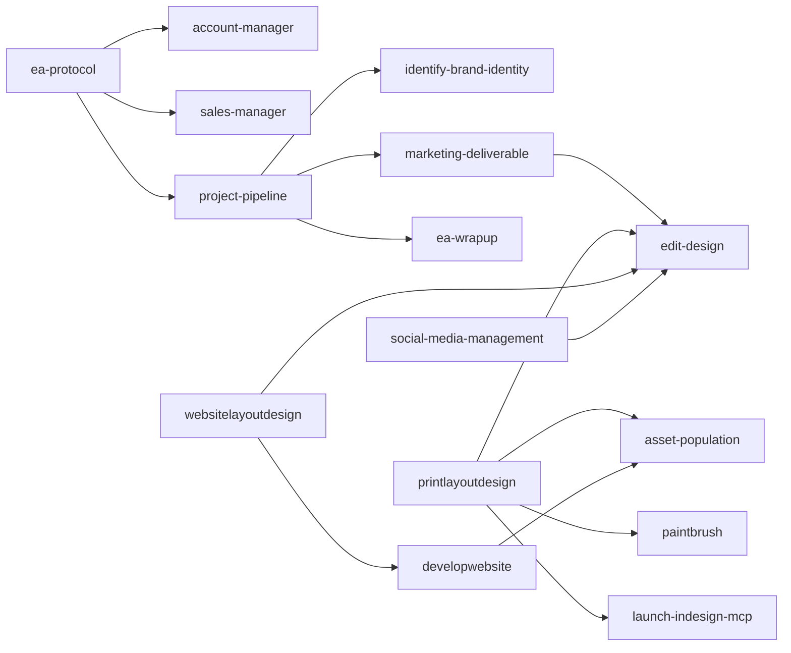

# Svetlana handoff

## Recommended design stack

Use **Grok Bot as the design brain** for briefs, visual critique, QA, and orchestration. Run this **Svetlana repository in Claude Code** for repeatable skills, guarded operations, scripts, and handoffs. Use **Adobe InDesign through the configured InDesign MCP/automation layer** for professional layout and final production.

That division is intentional:

- Grok Bot reasons about visual direction and critiques output.
- Svetlana/Claude Code owns repeatable process, source-grounded context, approvals, and automation.
- InDesign owns typography, colour management, pagination, preflight, packaging, and exports.

### Canva, candidly

The Canva MCP produced poor results in the source system. It was less controllable, consumed more tokens during iterative correction, and did not approach InDesign's output quality. InDesign was materially better and more token-efficient. For serious agency production, use InDesign. Canva can remain an optional convenience tool for simple template edits, but it is not part of this release's default MCP configuration.

The private `.mcp.json` reached Canva through `mcp-remote` and Canva's hosted MCP endpoint (`https://mcp.canva.com/mcp`, no credential in the URL). That server entry was removed here. The quality judgment above is operational experience from the source system, not something this repository measures.

## How MCP and InDesign actually work here

The sanitized `.mcp.json` declares three servers and calls them directly (the private config wrapped `npx` in Windows `cmd /c`):

1. `indesign`: `node <INDESIGN_MCP_ROOT>/src/index.js`.
2. `playwright`: `npx -y @playwright/mcp@0.0.83` for Claude Code browser tools. This is separate from the Python `playwright` package `scripts/comp_measure.py` uses to measure HTML comps.
3. `pinecone`: `npx -y @pinecone-database/mcp@0.3.0`, with `PINECONE_API_KEY` passed through as `${PINECONE_API_KEY}`.

Those package pins are the ones in this branch. The private config pinned the older `@playwright/mcp@0.0.78` and `@pinecone-database/mcp@0.2.1`. Treat the public pins as declared dependencies, not as a claim that they were the versions exercised in production.

The tracked source repository did **not** contain the external `indesign-uxp-server` package referenced by its MCP config, so this public branch does not pretend to ship it. Supply that server separately and replace `<INDESIGN_MCP_ROOT>`. This is an open handoff item, not a hidden dependency.

The retained automation has two transports:

- Preferred on Windows: `scripts/idcom.py` calls `app.DoScript(..., UXPSCRIPT)` (`SCRIPT_LANGUAGE_UXPSCRIPT` is `1431522407`). UXP JavaScript imports `require("indesign")`. Results return through a temporary application label (`insertLabel` / `ExtractLabel`) because UXPSCRIPT does not reliably return values through COM. ProgIDs tried, in order, are `InDesign.Application` and `InDesign.Application.2025`. `GetActiveObject` attaches to a running instance; if that fails, `Dispatch` can start InDesign.
- Fallback: `scripts/idbridge.py` posts the same UXP code to `INDESIGN_BRIDGE_URL`, defaulting to `http://127.0.0.1:3000` and appending `/execute`. Set `SVETLANA_ID_TRANSPORT` to `com`, `http`, or `auto` (the default). The private helper used the env name `SVETA_ID_TRANSPORT` and a hard-coded loopback URL. The source architecture used a Node HTTP server plus a UXP panel/WebSocket bridge; the separate server also exposed MCP tools to Claude Code.

Run `python scripts/indesign_check.py`. Only a real `return 'alive'` round-trip counts as healthy. A status endpoint alone can be stale.

The print pipeline is file-based at the orchestration layer:

- Python files such as `comp_to_indesign.py` and `indesign_preflight.py` hold reviewable UXP script templates.
- They send small, paced UXP programs one section at a time and read each result before continuing.
- `illustrator-batch-export` generates reviewable `.jsx` files on disk for Illustrator.
- No standalone `.idjs` files were tracked in the source. InDesign UXP snippets were generated by Python and sent through COM/HTTP; claiming otherwise would be inaccurate.

### Windows notes

- COM requires Windows, Adobe InDesign, and `pywin32`.
- Start InDesign normally. `GetActiveObject` attaches to the running instance. The `Dispatch` fallback can launch InDesign; this release has no separate launcher and does not kill creative applications. `INDESIGN_EXE` is only a placeholder for a launcher you build yourself.
- Use absolute paths at the InDesign boundary and convert backslashes to forward slashes inside UXP code.
- `comp_to_indesign.py` and `indesign_preflight.py` address documents by exact name. `brand_tokens.py` observation opens a named file only when it is not already open, and closes only that document when this call opened it. `idbridge.py` helpers `info`, `frames`, `pdf`, `saveas`, and `close` still use the active document, and `close` closes it without saving. Do not point those helpers at a document the agent did not open.
- The optional UXP bridge should bind to loopback only. Treat ports, plugin IDs, and machine paths as local configuration.

## Configuration

1. Copy `.env.example` to a private `.env`.
2. Replace placeholders only for integrations you use.
3. Replace `<INDESIGN_MCP_ROOT>` in `.mcp.json`.
4. Install Python dependencies with `python -m pip install -r requirements.txt`. Install `health-app/requirements.txt` if you run the health API or `python -m pytest` (those tests import FastAPI). On Windows, install `pywin32` separately for COM; it is not pinned in `requirements.txt`.
5. Install the Python Playwright browser if using measured comps (`scripts/comp_measure.py`). That package is not the MCP server pinned in `.mcp.json`.
6. Run `python scripts/indesign_check.py` on the Windows/InDesign host.
7. Keep private brand, CRM, financial, health, transcript, and state stores outside this repository.

Claude Code project MCP configuration lives in `.mcp.json`. User-wide Claude Code settings vary by install; if you move the server declaration there, use a placeholder path such as `<CLAUDE_CONFIG_ROOT>` and keep secrets in environment variables.

## Skill chain

The diagram shows the forward session and production direction taken from each skill's `calls` field. It is not every edge. Several pairs call each other (`ea-protocol` and `account-manager`, `email-workflow` and `newsletter-build`, `sales-manager` and `opportunity-engine`). `health-coach` is an independent trigger, not a step inside `ea-protocol`. `printlayoutdesign`, `websitelayoutdesign`, and `social-media-management` are medium entry points; `marketing-deliverable` does not call them.



## Every included skill

| Skill | Trigger | Calls / handoff | Tech dependency | What to swap |
|---|---|---|---|---|
| `account-manager` | proactive account check-ins, stale client contact, or an account review | `ea-protocol, status-update` | Gmail, CRM | Replace Gmail/CRM adapters with your mail and customer systems. |
| `asset-population` | a finished layout needs real logos, photography, icons, or motifs | `identify-brand-identity, edit-design, paintbrush` | InDesign or CMS, file/asset storage | Replace InDesign/CMS placement with the target design tool's asset API. |
| `autosave` | periodic save checkpoints or context-compaction risk | `none` | local filesystem | Point the state path at your own private, ignored store. |
| `brand-research-dossier` | new-brand research, competitor analysis, or pre-mood-board discovery | `reference-capture, identify-brand-identity` | web research, optional browser automation | Use your preferred search and browser-capture tools. |
| `brandscript` | brand story, positioning narrative, or foundational messaging | `identify-brand-identity, copyeditor` | brand profile | Use any structured brand repository that can supply approved facts. |
| `brief-machine` | a contractor or teammate needs a production brief | `delegation-oscillation, team-comms, copyeditor` | Gmail, task manager | Replace Gmail/task creation with your team communication stack. |
| `build-etransfer-invoice` | an approved billing milestone requires an invoice draft | `copyeditor` | accounting provider, Stripe or bank transfer, optional InDesign | Replace payment rails and tax rules with your jurisdiction and accounting tool. |
| `captain` | system status board, capability inventory, or build audit | `inventory-counts-reconcile` | Git, local project metadata | Use your issue tracker or project database as the status source. |
| `colour-information` | accurate HEX, RGB, CMYK, or spot-colour information is required | `launch-indesign-mcp, palette-qa` | InDesign colour engine | Use another colour-managed application; do not substitute naive formulas. scripts/brand_tokens.py can also read print-PDF vectors through optional PyMuPDF, which is not pinned in requirements.txt. |
| `copyeditor` | proofreading, correctness, consistency, or final editorial QA | `none` | none | No integration required. |
| `copywriting` | new or rewritten marketing-page copy | `brandscript, editorial-copy, copyeditor` | brand profile and approved offer facts | Use your own brand repository and CMS. |
| `delegation-oscillation` | deciding whether the owner, agent, or teammate should perform work | `brief-machine` | task manager, team capacity data | Replace the task manager and rate/capacity inputs. |
| `design-best-practices` | any print, web, social, or hybrid visual task | `edit-design, icon-selection` | brand tokens and reference library | Point references at your own approved design doctrine. |
| `developwebsite` | an approved web build specification is ready for implementation | `web-conversion-doctrine, websitelayoutdesign, edit-design, asset-population` | WordPress/Elementor, browser automation | Replace the CMS adapter with Webflow, a framework, or another builder. |
| `ea-protocol` | session start, daily briefing, catch-up, or agenda setting | `account-manager, sales-manager, project-pipeline` | Google Calendar, Gmail, Motion, Stripe | Replace each read adapter independently; preserve read-before-analysis order. |
| `ea-wrapup` | session end, logging off, or explicit wrap-up | `status-update, autosave` | task manager, Slack, private state store | Replace Motion/Slack with your project and team tools. |
| `edit-design` | every visual edit to HTML, CSS, SVG, InDesign, or another design surface | `design-best-practices, icon-selection` | browser capture or InDesign | Use the target application's capture/export mechanism. |
| `editorial-copy` | existing marketing copy needs stronger persuasion or clarity | `copyeditor` | none | No integration required. |
| `email-send` | an approved email is ready for delivery preparation | `email-workflow, copyeditor` | Mailchimp or another ESP | Replace campaign creation and test-send adapters with your ESP. |
| `email-workflow` | newsletter, campaign, nurture, automation, template, or list-hygiene work | `newsletter-build, email-send` | ESP, CASL-compliant consent records | Replace the ESP while retaining consent, suppression, and approval gates. |
| `health-coach` | food, meal, nutrition, weight, body-composition, workout, or health check-in | `scripts/health_validate.py, scripts/health_targets.py, scripts/health_log_lint.py, scripts/health_daily_union.py, scripts/health_usda.py, scripts/_health_meal_calc.py, scripts/burn_estimate.py` | Python, PyYAML, sourced catalog; optional `USDA_API_KEY` | Replace fitness providers freely, but never replace the catalog provenance validator. |
| `hoarding-pipeline` | asset intake starts or required materials are missing | `identify-brand-identity, asset-population` | Google Drive or file storage, Gmail | Replace storage and intake adapters. |
| `icon-selection` | a visual layout needs icons, motifs, or supporting graphics | `edit-design` | approved brand asset library | Use your own licensed icon library. |
| `identify-brand-identity` | brand ingestion or the first brand-matched deliverable | `palette-qa` | file storage, web/browser access | Replace local-drive and web-source adapters. |
| `illustrator-batch-export` | batch export of logos, icons, patterns, or artboards from Illustrator | `copyeditor` | Adobe Illustrator, ExtendScript, Windows or macOS | Use Illustrator actions or another vector application's scripting API. |
| `inventory-counts-reconcile` | a document contains categorical counts, rollups, or a definition-of-done table | `none` | none | No integration required. |
| `launch-indesign-mcp` | InDesign automation is needed or its connection fails | `scripts/idbridge.py, scripts/idcom.py` | Windows, Adobe InDesign, pywin32; optional external UXP/MCP bridge | On non-Windows hosts, set INDESIGN_BRIDGE_URL and use the external UXP bridge or another InDesign automation host. Set SVETLANA_ID_TRANSPORT to com, http, or auto. |
| `marketing-deliverable` | any requested design or marketing deliverable | `project-pipeline, design-best-practices, edit-design, copyeditor` | depends on selected medium | Replace production adapters while preserving review gates. |
| `meeting-ingest` | a meeting summary or transcript arrives | `status-update, project-pipeline` | Gmail, Motion or another note taker, CRM | Replace the meeting-note and CRM adapters. |
| `newsletter-build` | newsletter content and design production | `email-workflow, edit-design, copyeditor, email-send` | ESP, HTML email tooling | Replace Mailchimp with your ESP; retain rendering and consent checks. |
| `offload` | work should be captured for later rather than done now | `delegation-oscillation` | Motion or another task manager | Replace task creation with your queue system. |
| `opportunity-engine` | revenue-move review or an approved deliverable/deal creates a follow-up opportunity | `sales-manager, status-update` | CRM | Replace the CRM query adapter. |
| `paintbrush` | an approved layout needs brand colour and typography applied | `identify-brand-identity, colour-information, edit-design, asset-population` | InDesign or target design tool | Replace swatch/style APIs for the target application. |
| `palette-qa` | a palette needs WCAG and light/dark usability checks | `scripts/palette_qa.py` | Python | Any standards-compliant contrast engine can replace the script. |
| `printlayoutdesign` | proposal, guide, magazine, card, sign, sheet, or other print layout | `design-best-practices, edit-design, paintbrush, asset-population, launch-indesign-mcp` | InDesign, Windows COM or UXP bridge, Playwright for measured HTML comps | Replace InDesign transfer with another professional layout engine. |
| `project-pipeline` | a new internal or client deliverable starts | `delegation-oscillation, identify-brand-identity, marketing-deliverable, ea-wrapup` | task manager and private project state | Replace Motion/private state with your project system. |
| `reference-capture` | a URL, video, or HTML reference must be deconstructed | `websitelayoutdesign, brand-research-dossier` | Playwright/browser capture; optional video tools | Use another deterministic capture stack. |
| `sales-manager` | pipeline, forecast, lead-stage, or revenue-priority review | `status-update, opportunity-engine` | HubSpot or another CRM | Replace CRM reads and your private financial thresholds. |
| `social-media-management` | social account onboarding, monthly planning, production, or reporting | `project-pipeline, edit-design, copyeditor` | social scheduler, design tool, analytics | Replace platform-specific scheduling and reporting adapters. |
| `status-update` | a lead, client, deal, or project gains a status-relevant fact | `sales-manager` | HubSpot or another CRM | Replace CRM writes with your system's reviewed upsert. |
| `svetlana-slackbot-connect` | the local Slack bot must start, reconnect, or be checked | `team-comms` | Slack, Node or Python bot runtime | Replace Slack with Teams, Discord, or another approved channel. |
| `tagline` | tagline, slogan, motto, or short brand line | `brandscript, copyeditor` | brand profile | No integration required. |
| `team-comms` | a teammate needs a routine brief or an approved internal message | `brief-machine` | Slack or Gmail, private team roster | Replace channel adapters and roster source. |
| `web-conversion-doctrine` | before any website layout or build | `websitelayoutdesign, developwebsite` | none | Replace reference doctrine with your approved web standards. |
| `websitelayoutdesign` | website wireframe, page layout, or approved web-design comp | `web-conversion-doctrine, design-best-practices, edit-design, developwebsite` | HTML/CSS, Playwright; optional InDesign transfer | Use Figma or another measured layout surface if it can emit a build spec. |

### Upstream skill aliases not bundled

The private tree also contained 26 bracket-prefixed reference aliases copied from external skill packs: `frontend-design`, `skill-creator`, seven Slack helpers, three Stripe helpers, and fourteen Superpowers development helpers. They are not part of Svetlana's 45 custom routable skills and are intentionally excluded because their upstream provenance and redistribution terms were not established.

Install current versions from their original providers if you need them. The omitted groups cover:

- Slack channel search, summaries, standups, announcements, and messaging.
- Stripe best practices, error explanations, and test-card references.
- Superpowers planning, debugging, testing, worktrees, review, subagent, and skill-authoring workflows.
- General frontend-design and skill-creation guidance.

Do not recreate these files from the private branch or treat the names as proof that they are licensed for redistribution.

## Health coach component

The public health component keeps the reusable anti-fabrication boundary:

- `scripts/health_validate.py` accepts only a closed set of provenance formats and checks macro coherence.
- `scripts/health_targets.py` performs deterministic target calculations from a private profile. Basal metabolic rate is Mifflin-St Jeor for an explicit `female` or `male` sex. A missing sex is an error. Optional pregnancy modes add the published trimester calorie deltas (0, 340, and 450 kcal) or a clinician override stored only in the private profile.
- `scripts/health_log_lint.py` checks dated meal-log structure and reconciles line items to declared totals. Summary lines are any short bullet containing "total". Notes are generic markers (`note:`, `non-food:`, `owner-estimated`, `macros not itemized`). Activity lines use generic words such as steps, walk, and burned. It does not special-case a person's foods, supplements, or wearable vendor.
- `scripts/health_daily_union.py` builds a daily read model from separately owned food and burn inputs.
- `scripts/health_usda.py` looks up FoodData Central records with an optional `USDA_API_KEY` and writes source-attributed catalog entries.
- `scripts/_health_meal_calc.py` derives recipe totals only from validated per-100g catalog values.
- `scripts/burn_estimate.py` can estimate burn from at least 30 complete, non-suspect historical days; every result stays explicitly estimated and must not train measured-history calculations.
- `.claude/skills/health-coach/SKILL.md` requires validation before any nutrition number is quoted or logged.
- `health-app/` exposes only a small local validator API.
- `health/` contains a synthetic schema fixture, not a person's records.

Store real profiles, meals, weights, workouts, wearable exports, label photos, generated caches, and transcripts in a private repository. The sample catalog record exists only to exercise the validator and must not be used as coaching data. Fitness-provider sync is intentionally adapter territory; swapping a wearable provider must not weaken catalog provenance or blur measured values with estimates.

## Cockpit

`cockpit/` is a sanitized local dashboard shell. It binds to loopback, reads configuration from environment variables, and demonstrates replaceable panels without shipping CRM, pipeline, health, or financial records. The original cockpit implementation was written by Tom Lyons; this branch keeps the MIT notice in `cockpit/LICENSE`. Start it with:

```bash
cd cockpit
npm test
npm start
```

Use the panel interface as the seam for Motion, HubSpot, Google Workspace, Stripe, Slack, or PocketBase. Do not expose the cockpit to a network without a security review and stronger authentication.
